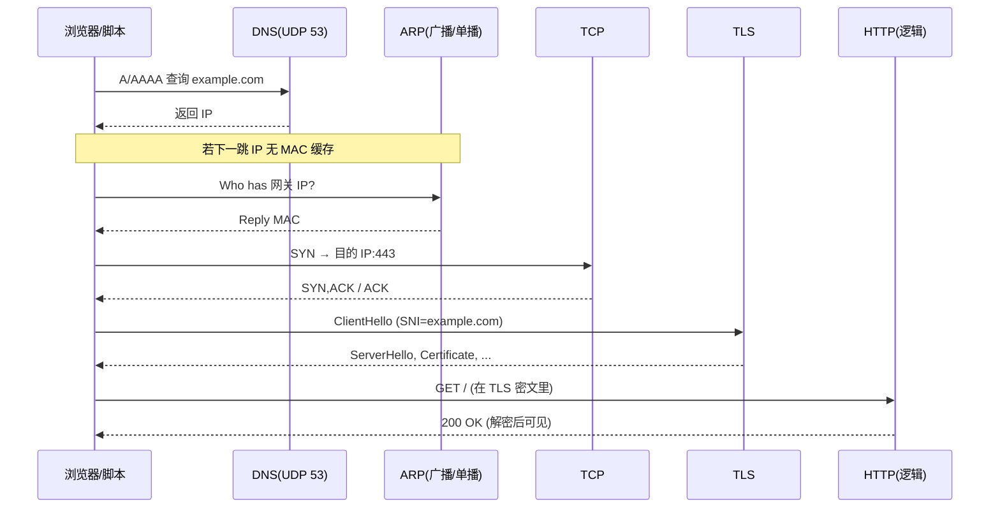

# 第八课：一次 HTTPS 访问走过哪些包？

把 **01～07** 收成一条时间线：你在浏览器输入 `https://example.com` 时，线上大致按什么顺序出现各类报文？

## 1. 总览时间线



| 阶段 | 课次 | Wireshark 过滤器提示 |
|------|------|----------------------|
| DNS | 05 | `dns` |
| ARP | 06 | `arp` |
| TCP 握手 | 03 | `tcp.flags.syn==1` |
| TLS | 07 | `tls.handshake.type==1` |
| HTTP | 04 | 明文站 `http`；HTTPS 仅能看 TLS |

## 2. 二层/三层细节（别忘）

- **ARP** 只解析 **下一跳**（多为网关），以太网目的 MAC 不是网站机的 MAC（06）。
- **IP 目的地址** 仍是网站 IP；路由器靠路由表逐跳转发（02）。
- **ping** 走 ICMP，不经过 443，但可用来验证「到某 IP 是否可达」（05）。

## 3. NAT（在家上网几乎必经）

家庭路由器常做 **SNAT**：内网 `192.168.x.x` 换成公网 IP，**源端口**可能改写，让多台设备共用一个公网地址。

- 出站：内网 IP:端口 → 路由器记表 → 换成公网 IP:新端口  
- 回程：路由器查表还原 → 转回内网那台电脑  

抓包时：在 **路由器 WAN 侧** 与 **本机网卡** 看到的源地址可能不同——这是正常的，不是「IP 坏了」。

本课 `nat_concept.py` 只做**表格式演示**，不修改你网络。

## 4. 怎么运行

```bash
cd lesson-08-一次访问的全链路
python full_path_walkthrough.py
python trace_https_visit.py
python nat_concept.py
python default_route_hint.py
```

`trace_https_visit.py` 会在一台机器上**真实走完**：DNS → 提示 ARP → TCP → TLS → GET（需联网）。

抓包建议：开始捕获 → 运行 `trace_https_visit.py` → 按 `WIRESHARK_TIMELINE.md` 逐项过滤。

## 5. 小测验

1. DNS 查询通常用 TCP 还是 UDP？  
2. 访问外网 HTTPS 时，第一个 ARP 往往在问谁？  
3. 在哪一层「看不见」HTTP 明文（默认抓包）？

<details>
<summary>参考答案</summary>

1. 多数情况 **UDP** 53（大包/区域传送等场景可能 TCP）。  
2. **默认网关** 的 MAC。  
3. **TLS 应用数据** 阶段（第七课）。

</details>

## 之后学什么？

- 用 Wireshark **Follow → TCP Stream / TLS Stream** 对照本课时间线实抓一遍。  
- 选读：IPv6、QUIC（UDP 上的新传输）、无线网络 EAPOL（与第一课不同的链路层）。
